# TAÇKAPI Mobil — Önce / Sonra

7 Kasım sprintinin ekran karşılaştırması.

- **Önce:** `once/`, 2 Kasım sabahı, sprint öncesi.
- **Sonra:** `sonra/`, 2 Kasım, P10b sonu. Expo web, 390 × 844, Türkçe.
- **Sonra görüntülerindeki durum:** "Sonra" görüntülerinin çoğu temiz kurulumla alındı (boş pasaport). Pasaportun dolu hâli ve tam akış, aşağıdaki demo bölümünde.

## P0 ekranları

| Ekran | Önce | Sonra | Fark |
|---|---|---|---|
| Keşfet | 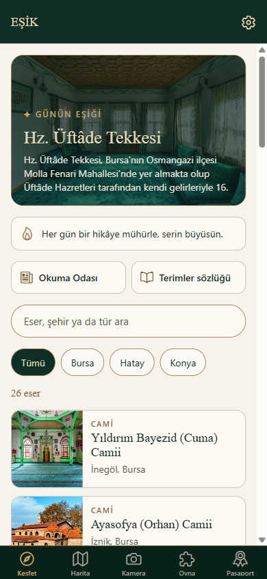 | 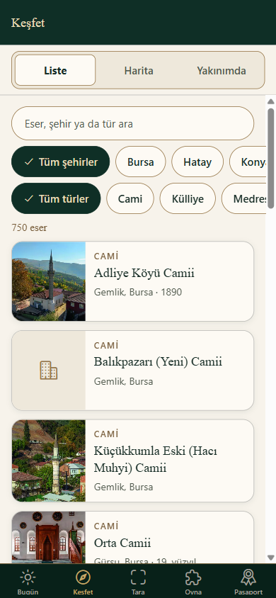 | Ana sayfadaki 744 eserlik katalog Keşfet sekmesine taşındı; Liste / Harita / Yakınımda tek bir seçiciyle, arama ve şehir/tür çipleri üçünde ortak. |
| Harita | 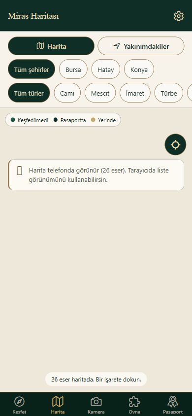 | 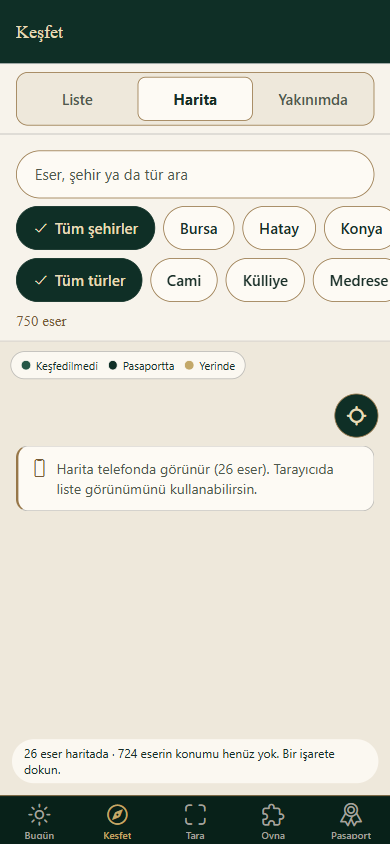 | Ayrı sekme olmaktan çıktı, Keşfet'in bir görünümü oldu; süzgeçler ve renk açıklaması haritanın üstünde (harita telefonda çizilir, web önizlemesinde yerine not görünür). |
| Kamera → Tara | 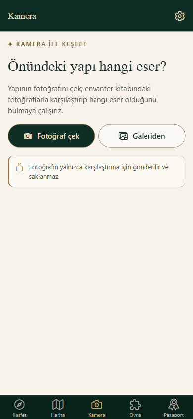 | 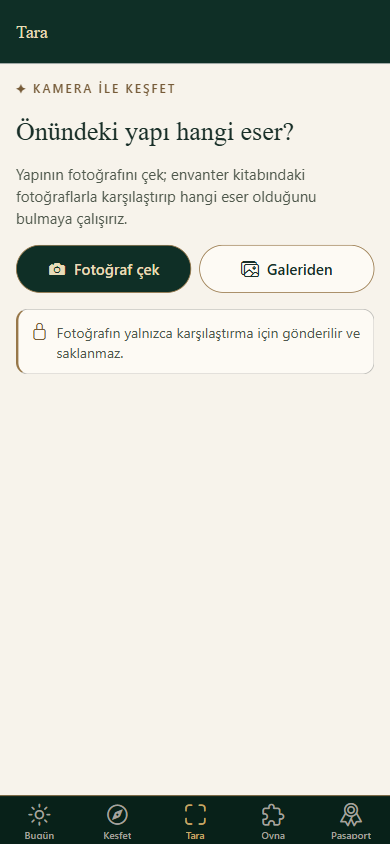 | Sekmenin adı "Tara" oldu; sonuç kartı ortak `Card`, yazılar tema ölçeğinde. |
| Oyna | 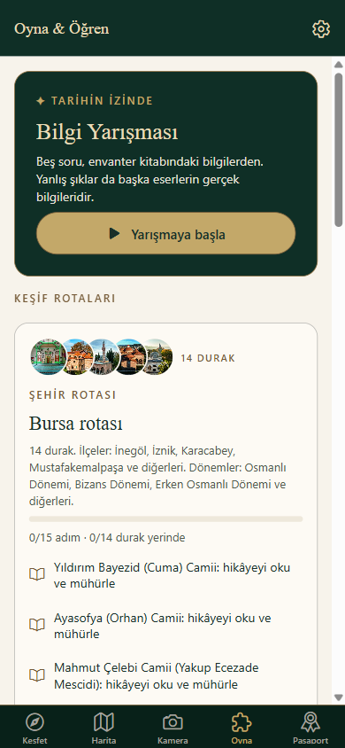 | 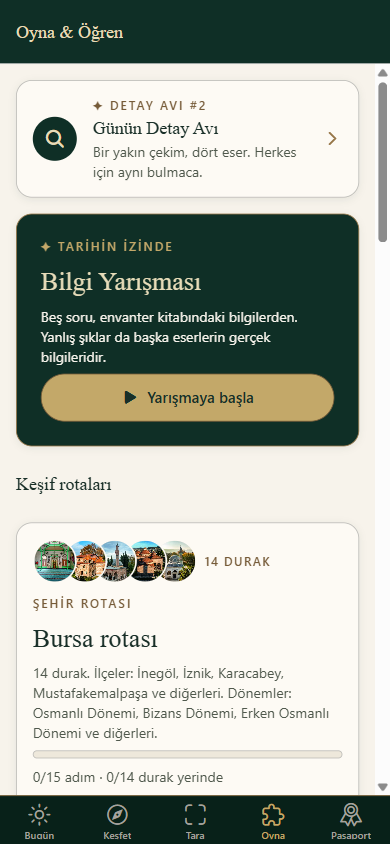 | En üste Günün Detay Avı geldi; rota kartlarında ortak ilerleme çubuğu, 44 px adım satırları ve serif bölüm başlığı var. |
| Pasaport | 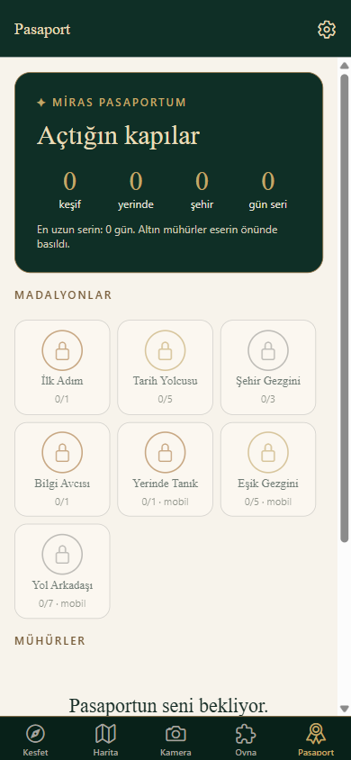 | 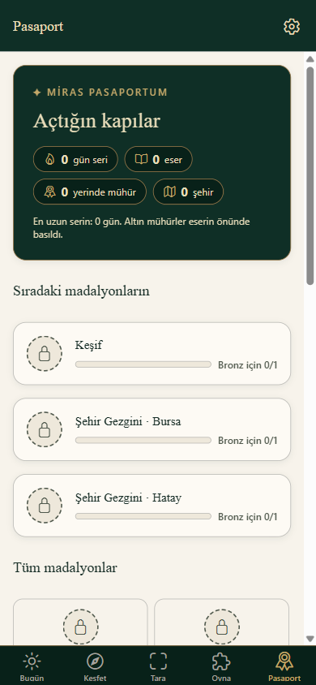 | 7 madalyonun yerini bronz/gümüş/altın kademeli aileler aldı; "Sıradaki madalyonların" ilerleme çubuklarıyla öne çıkıyor, seri izin günüyle sayılıyor. |
| Eser (üst) | 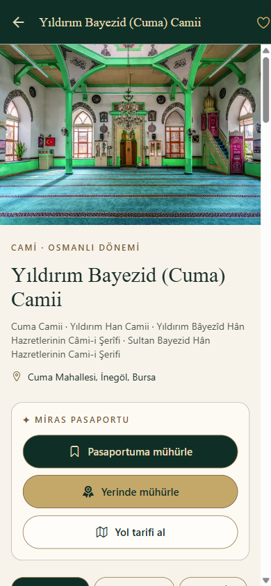 | 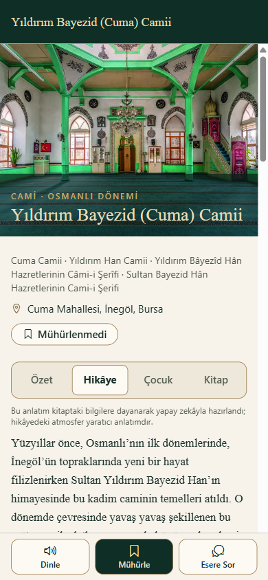 | Düğme yığını kalktı; mühür durumu tek bir çipte, Dinle / Mühürle / Esere Sor ekranın altındaki sabit çubukta. |
| Eser (orta) | 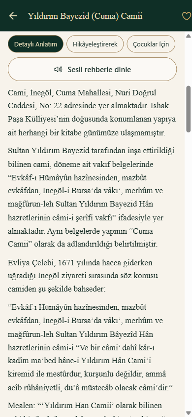 | 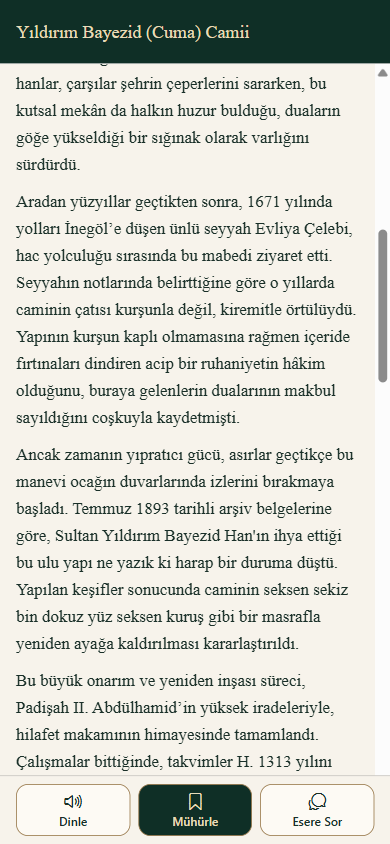 | Özet / Hikâye / Çocuk / Kitap anlatım seçicisi; metin düğmelerle bölünmeden okunuyor. |
| Eser (alt) | 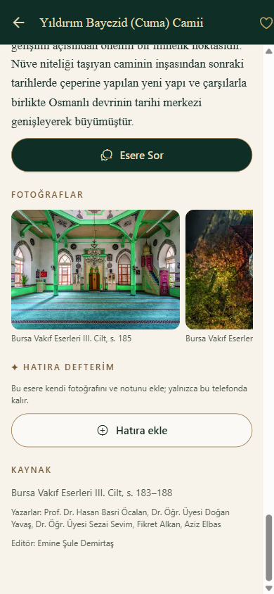 | 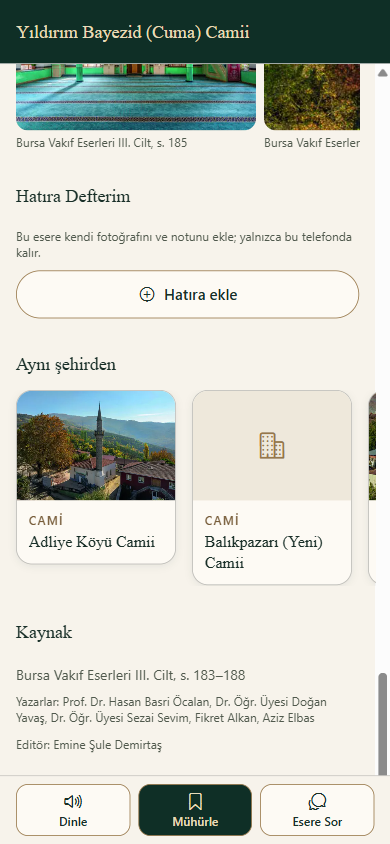 | "Aynı şehirden" eser şeridi eklendi; bölüm başlıkları ekranın geri kalanıyla aynı serif başlık oldu. |
| Esere Sor | 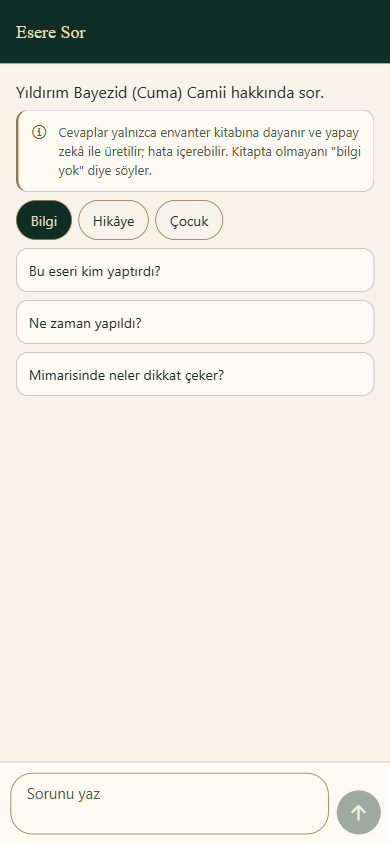 | 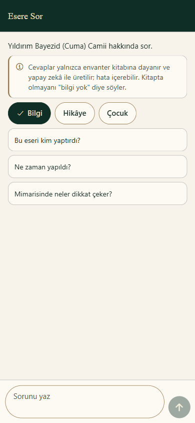 | Cevap türü çipleri 44 px ve seçilide onay işaretli; önerilen sorular etiketli. |
| Ayarlar | 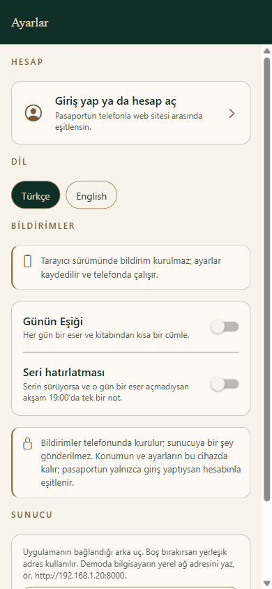 | 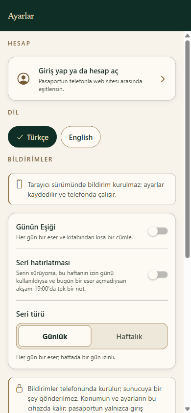 | Seri türü (günlük/haftalık) ve karşılamayı yeniden gösterme eklendi; dil ve saat seçimi ortak çiplerle, kartlar ortak `Card` ile. |

## Yeni ekranlar (öncesi yok)

| Ekran | Sonra | Ne |
|---|---|---|
| Bugün (üst) | 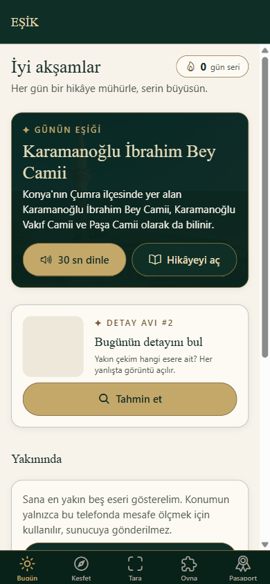 | Yeni ana sayfa: selam ve seri, Günün Kapısı (dinle / aç), Detay Avı; kaydırmadan üç eylem. |
| Bugün (alt) | 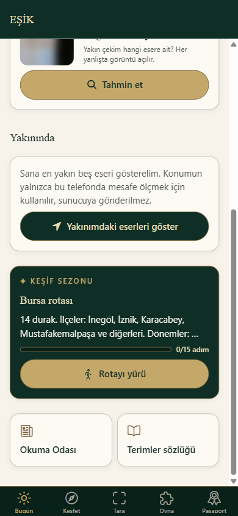 | Yakınında, Keşif Sezonu rotası, Okuma Odası ve sözlük kısayolları. |
| Karşılama 1 | 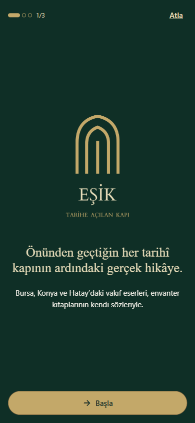 | Değer önerisi tek cümlede; atlanabilir. |
| Karşılama 2 | 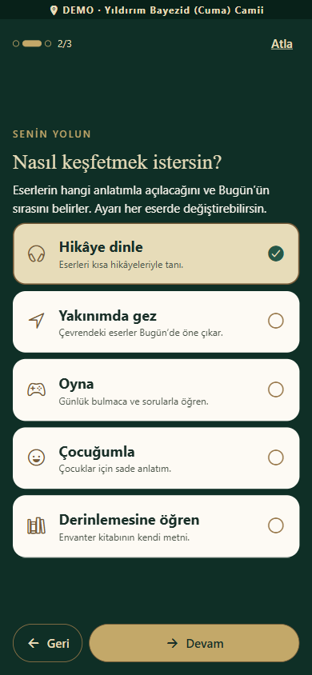 | "Nasıl keşfetmek istersin?" seçimi; anlatımı ve Bugün'ün sırasını belirler. |
| Karşılama 3 | 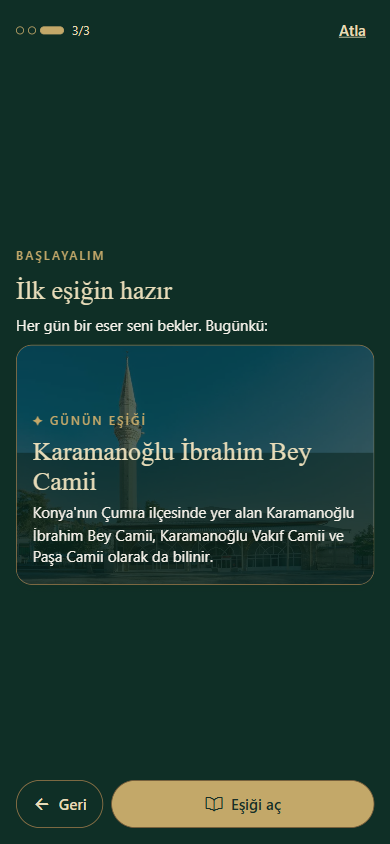 | Günün Kapısı hazır; doğrudan açılır. |
| Detay Avı | 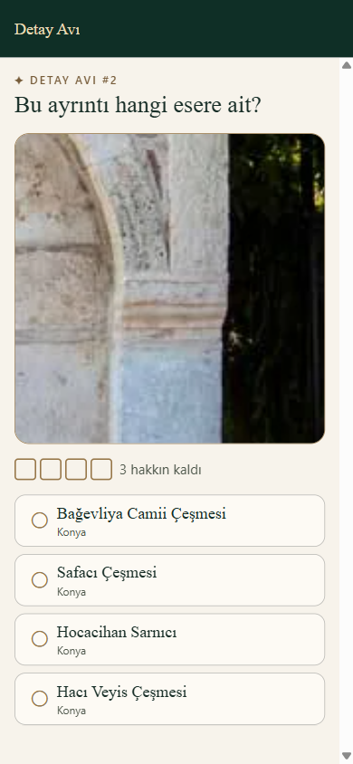 | Günlük yakın çekim bulmacası; dört şık, her yanlışta görüntü açılır. |
| Hatırla (boş) | 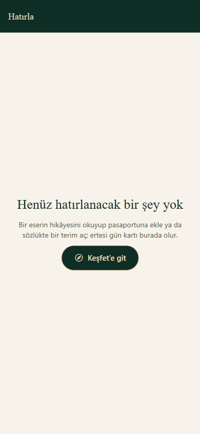 | Keşif yokken ne yapılacağını söyleyen boş durum. |
| Rota yürüyüşü | 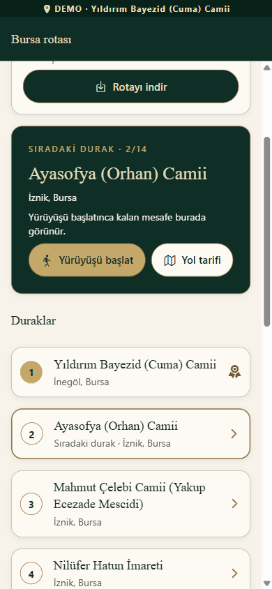 | Çevrimdışı paket, sıradaki durak kartı, sıradaki durak listede yazıyla da belirtiliyor. |
| Ayarlar → Sunum | 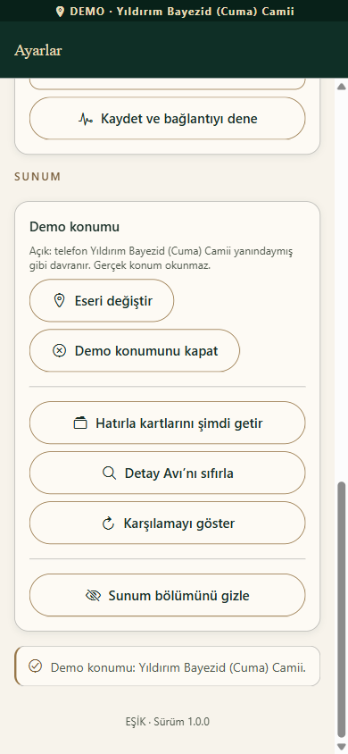 | Gizli demo bölümü: demo konumu, Hatırla kartlarını getir, Detay Avı'nı sıfırla, karşılamayı göster. |

P2–P10a görevlerinde alınan ayrıntılı durum görüntüleri (boş, çevrimdışı, EN, hata) `sonra/p*-*.png` dosyalarında.

## Demo senaryosu (sprint planı bölüm 5)

| Adım | Görüntüler |
|---|---|
| 1. İlk açılış → Hikâye dinle → Bugün | [karşılama 1](sonra/11-karsilama-1.png), [2](sonra/11-karsilama-2.png), [3](sonra/11-karsilama-3.png), [Bugün](sonra/demo-1-bugun.png) |
| 2. Günün Kapısı → dinle → eser → Çocuk | [dinle](sonra/demo-2a-dinle.png), [Günün Kapısı eseri](sonra/demo-2b-gunun-esigi-eser.png), [Çocuk anlatımı](sonra/demo-2c-eser-cocuk.png) |
| 3. Demo konumu → Yerinde mühürle | [Sunum](sonra/15-ayarlar-sunum.png), [mühürden önce](sonra/demo-3a-yerinde-muhurle.png), [altın mühür](sonra/demo-3b-altin-muhur.png), [paylaşım kartı](sonra/demo-3c-paylasim-karti.png) |
| 4. Detay Avı, iki tahminde | [başlangıç](sonra/demo-4a-detay-avi.png), [bir yanlış](sonra/demo-4b-bir-yanlis.png), [buldun](sonra/demo-4c-buldun.png), [adsız paylaşım](sonra/demo-4d-paylasim.png) |
| 5. Hatırla, 3 kart | [Bugün kartı](sonra/demo-5a-bugun-hatirla.png), [kart](sonra/demo-5b-hatirla-kart.png), [cevap](sonra/demo-5c-hatirla-cevap.png), [özet](sonra/demo-5d-hatirla-ozet.png) |
| 6. Pasaport | [seri ve izin günü](sonra/demo-6a-pasaport.png), [madalyonlar](sonra/demo-6b-madalyonlar.png) |

## Tablet (7 Kasım)

Tablette içerik kenardan kenara uzuyordu: düğmeler 1.000 px'lik çubuklara dönüşüyor, simge bir uçta, yazı ortada kalıyordu.
Artık uygulamanın tamamı (başlık, ekranlar, sekme çubuğu) `measure.app` (680) genişliğinde ortalanıyor, iki yan gece
zemini. Expo web, Türkçe; telefon (390) görünümü değişmedi.

| Ekran | Önce | Sonra |
|---|---|---|
| Bugün, 1024 × 1366 | 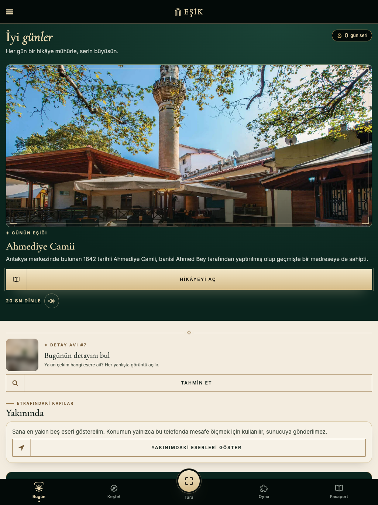 | 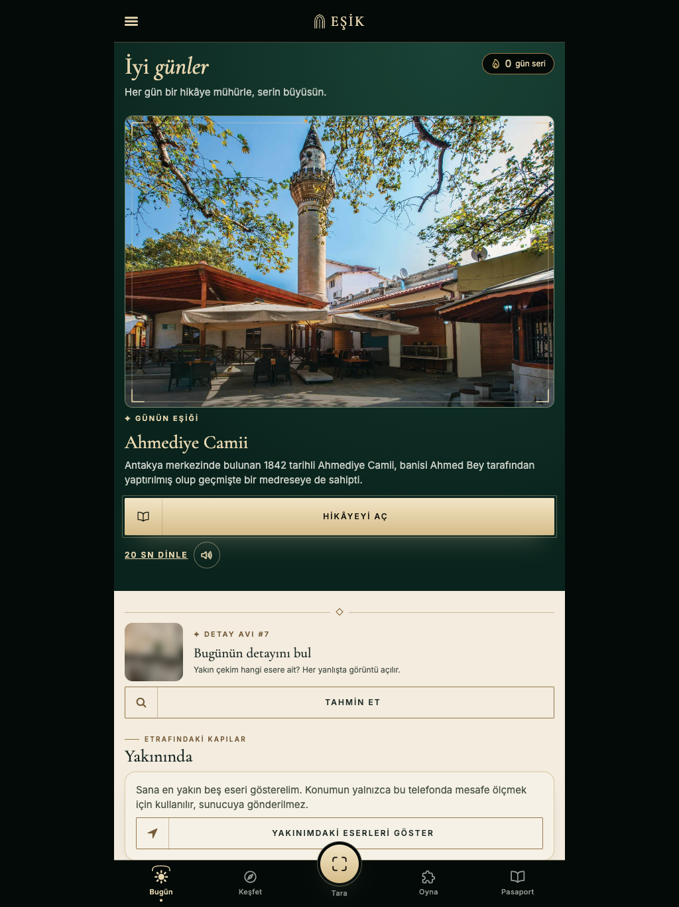 |
| Oyna, 768 × 1024 | 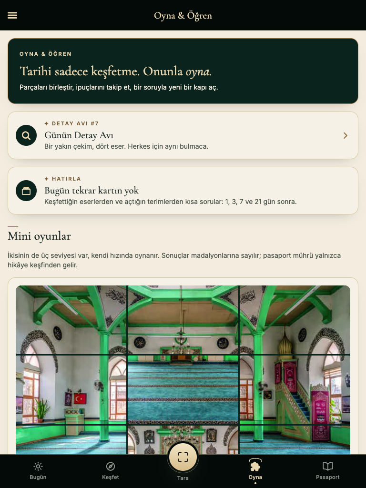 | 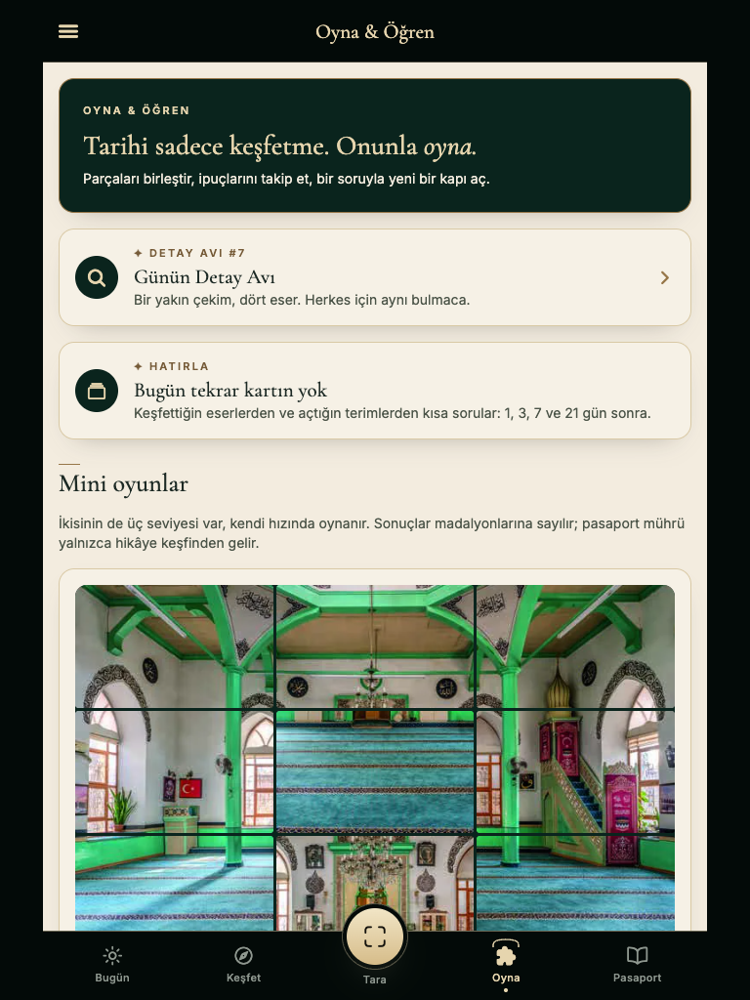 |

## Dar telefon (7 Kasım)

Dar telefonlarda (320–375 px) yan yana butonların yazısı iki satıra kırılıyor, 320 px'te butondan taşıyordu; uzun buton
yazıları tek kelimesi alt satıra düşerek bölünüyordu. Artık 400 px altında buton harfleri biraz daha sık duruyor, sığmayan
uzun yazı bir kademe daha sıklaşıyor, yan yana butonlar (`ButtonRow`) yazı sığmayınca alt alta geçiyor.

| Ekran | Önce | Sonra |
|---|---|---|
| Tara, 320 × 640 | 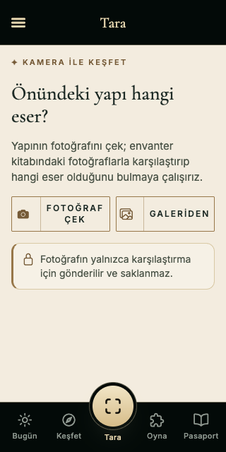 | 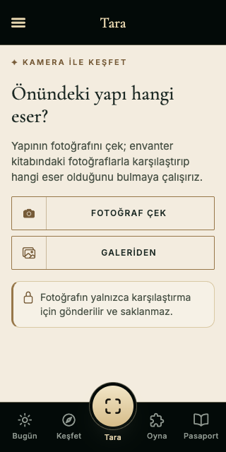 |
| Bugün, 360 × 740 | 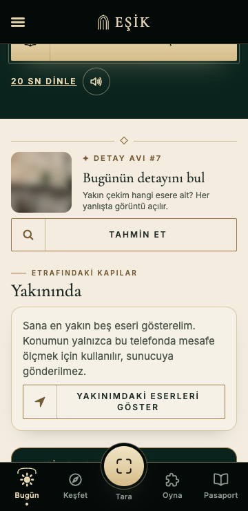 | 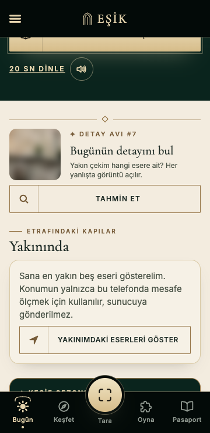 |
